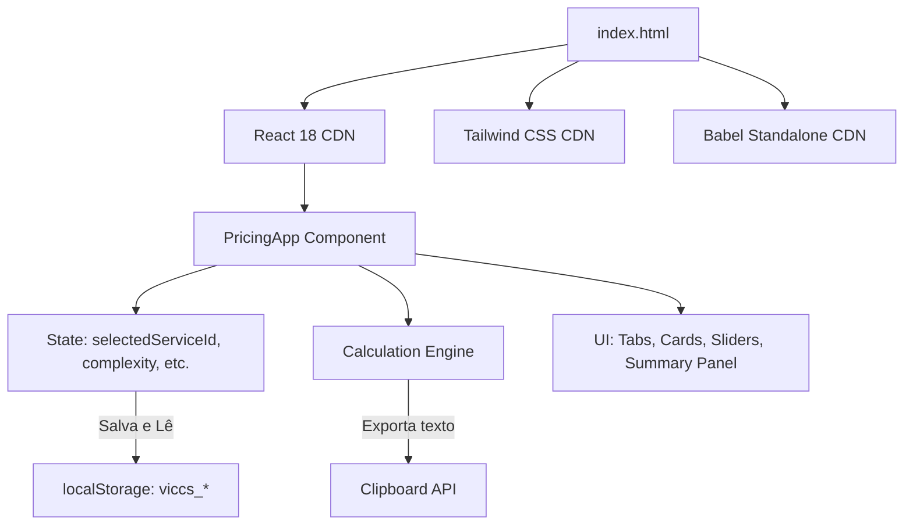

# Arquitetura do Sistema

## Padrão Arquitetural: Single-File Application (SFA)
O **VICCS Pricing** foi concebido como uma aplicação cliente-side de arquivo único (`index.html`), projetada para ser extremamente rápida de carregar, rodar localmente sem necessidade de compiladores locais, e facilmente hospedável em serviços estáticos como Vercel ou GitHub Pages.

## Componentes e Tecnologias Core

### 1. In-Browser Transpilation (Babel)
- **Babel Standalone** (`@babel/standalone` via CDN) é carregado no cabeçalho do documento.
- O script principal é definido com `type="text/babel"`, permitindo o uso direto da sintaxe JSX e ES6+ sem a necessidade de build steps complexos (Webpack, Vite, esbuild).

### 2. UI Reativa (React 18)
- O React é importado através de UMDs do unpkg.
- **Gerenciamento de Estado**: Totalmente contido no componente `PricingApp` usando hooks nativos (`useState`, `useEffect`, `useMemo`).
- **Estados Persistidos**:
  - `selectedServiceId`: Identificador do serviço selecionado.
  - `complexity`: Nível de complexidade do projeto.
  - `deadline`: Urgência ou prazo de entrega.
  - `extraRevisions`: Quantidade de revisões adicionais.
  - `estimatedHours`: Horas estimadas para cálculo de valor por hora.
  - `paymentMethod`: Método de pagamento escolhido.
  - `installments`: Quantidade de parcelas (para cartão parcelado).
  - `dimensionM2`: Dimensão em m² para serviços de impressão.
  - `observacoes`: Texto livre para notas.

### 3. Mecanismo de Cálculo de Preço (Calculation Engine)
Toda a lógica de precificação é centralizada em um bloco `useMemo` reativo que recalcula o subtotal e o total geral com base nos estados:
- **Serviços de Área**: Se a categoria do serviço for `impressao`, o preço base é calculado multiplicando `basePrice` por `dimensionM2`. Para outros serviços, o preço base é fixo.
- **Multiplicadores**: Aplicam-se as taxas acumuladas de complexidade e urgência.
- **Revisões**: Soma-se `revisions * R$50`.
- **Taxas de Pagamento**: Acréscimos de tarifas de processamento aplicadas sobre o subtotal.

### 4. Persistência de Dados
- Realizada inteiramente no `localStorage` sob o prefixo `viccs_`.
- Sincronização automatizada por meio de um `useEffect` observador de estados.

### 5. Exportação de Proposta (Clipboard)
- Uso da API `navigator.clipboard.writeText()` moderna.
- Fallback legado implementado via elemento temporário `<textarea>` e `document.execCommand('copy')` para máxima compatibilidade entre dispositivos.
