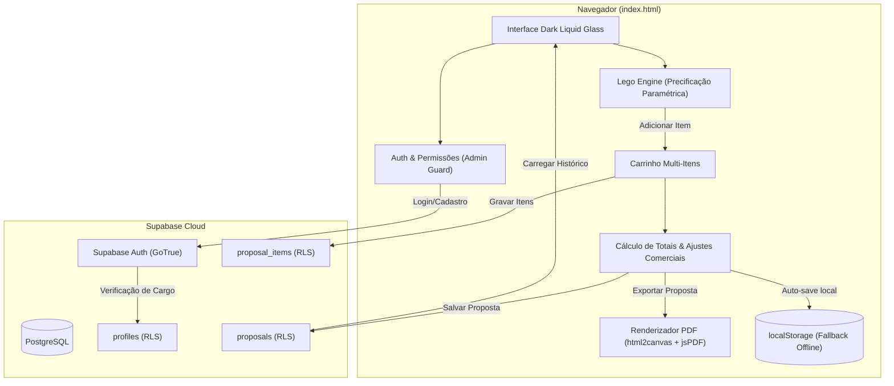

# Arquitetura do Sistema — VICCS Pricing Pro

## Padrão Arquitetural: Single-File Application (SFA) Reativa

O **VICCS Pricing Pro** foi concebido como uma aplicação cliente-side de alta performance empacotada em arquivo único (`index.html`), com transpilação JSX em tempo de execução via Babel Standalone, gerenciamento de estado unificado via React 18 e comunicação direta com a nuvem (Supabase).

---

## Componentes e Módulos Principais

### 1. Sistema de Autenticação e Autorização (Supabase)
- **Camada de Acesso:** Usuários não autenticados visualizam a tela de Login/Cadastro em card Liquid Glass.
- **Admin Guard:** Após login com e-mail e senha, o perfil do usuário é consultado na tabela `public.profiles`. Usuários com `is_admin = false` entram em tela de aprovação pendente.
- **Dev Mode Bypass:** Para desenvolvimento e testes locais rápidos sem conexão de rede, um atalho local permite operar em modo de administrador emulado.

### 2. Motor de Precificação Polimórfica (Lego Engine)
A precificação adapta seus parâmetros dinamicamente conforme a categoria do serviço selecionado:
- **Motion Design (`motion_custom`):**
  - Valor calculado por segundo: $V(s) = s \times T_{\text{estilo}} + A_{\text{sound}}$, onde $T_{\text{estilo}} \in \{15, 22, 35\}$ e $A_{\text{sound}} = 120$.
- **Impressão em Grandes Formatos (`impressao`):**
  - Valor calculado por área: $V(\text{área}) = (L \times A) \times P_{\text{metro}}$, com suporte a entrada em metros, centímetros e milímetros.
- **Serviços Standard (Identidade Visual, Social Media, Manutenção):**
  - Preço base multiplicado pelos fatores de complexidade ($0.9\times$ a $1.6\times$), prazo ($0.95\times$ a $1.6\times$) e revisões extras ($R\$ 50$ cada).

### 3. Carrinho Multi-Itens & Ajustes Comerciais
- Permite empilhar múltiplos itens no mesmo orçamento com snapshot de configurações no momento da inserção.
- Suporte a acréscimos operacionais (+R$) e descontos (-R$) com justificativas textuais explícitas repassadas para a proposta.
- Cálculo de formas de pagamento com taxas comerciais (PIX À Vista, PIX 50%+50%, Cartão 1x, Cartão Parcelado de 2x a 12x).

### 4. Engine de Exportação & Compartilhamento
- **Geração de PDF:** Renderização visual contínua via `html2canvas` com paginação A4 inteligente gerenciada por `jsPDF`.
- **Compartilhamento WhatsApp:** Formatação estruturada em texto com quebras de linha limpas, detalhamento de itens, prazos, formas de pagamento e chave PIX.
- **Drawer de Histórico:** Consulta assíncrona com busca por cliente em tempo real conectada à tabela `public.proposals`.
